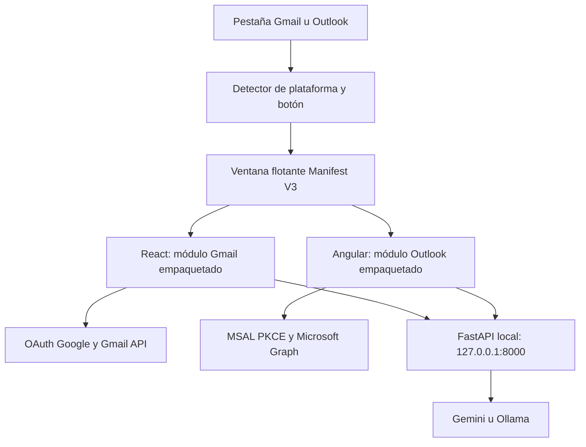

# Arquitectura de integración

## Estructura

- `extension/`: manifiesto, detección, botón, panel, opciones, adaptador de navegador, iconos y aplicaciones compiladas.
- `apps/gmail/`: fuentes React del primer proyecto, adaptadas para recursos locales y autorización nativa.
- `apps/outlook/`: fuentes Angular del segundo proyecto, incluido su historial, propuestas y avisos de entrega.
- `backend/`: FastAPI del proyecto Outlook más el adaptador de herramientas de Gmail, con configuración común y clave de enlace.
- `scripts/`: configuración inicial y compilación reproducible.

## Decisiones

Las interfaces se ejecutan como páginas empaquetadas de la extensión. No cargan un frontend de localhost ni código desde un CDN. La IA es un servicio local externo a la extensión, porque una clave de proveedor no debe incorporarse al JavaScript distribuido. Se conserva la separación React/Angular para integrar las funciones existentes sin una migración completa de frameworks.

Los content scripts solo insertan un botón aislado mediante Shadow DOM. No capturan cuerpos de correo ni credenciales. Las APIs de correo se llaman desde el módulo autorizado. Las acciones sensibles de Gmail se vinculan a un identificador de sesión y modo; la aprobación bloquea los intentos repetidos. No se realiza fallback de Gmail real a simulación al fallar una consulta.

El backend escucha solo en loopback. CORS permite orígenes de extensión Chromium y cada petición API requiere `X-EmailAgent-Token`. Las claves de IA se leen de variables de entorno del backend. No se registran claves ni se envían tokens de Gmail/Graph a la IA. El modelo recibe extractos de correo y contexto de conversación, por lo que deben utilizarse datos adecuados al plan y política del proveedor.

## Autorización

- Google: flujo de token para aplicaciones cliente mediante la ventana nativa de Chrome Identity, `state` aleatorio validado y callback exacto `chromiumapp.org/google`. Token de acceso temporal, sin Client Secret. Un coordinador en el service worker guarda el token en chrome.storage.session y recuerda únicamente la identidad en chrome.storage.local. Antes de cada operación, se reutiliza el token o se realiza una autorización no interactiva con prompt=none y login_hint de la misma cuenta. Google puede exigir una nueva confirmación, en cuyo caso se ofrece un botón de reautorización, sin entrada manual de tokens. No se utiliza refresh token. Los módulos no cambian de cuenta silenciosamente. Los scripts de contenido no pueden solicitar tokens al coordinador; solo las páginas de la propia extensión pueden hacerlo.
- Microsoft: MSAL con código y PKCE. Se intercepta la navegación de autorización y se abre con Chrome Identity. MSAL valida la respuesta y canjea el código. El callback `chromiumapp.org/microsoft` debe estar registrado como SPA. La navegación real del iframe no se redirige al proveedor.
- La cuenta del sitio web no autoriza automáticamente al módulo. La coincidencia de identidad no se infiere a partir de la URL de la pestaña.

## Compilaciones y límites conocidos

- React: comprobación TypeScript y compilación Vite completadas.
- Angular: compilación AOT de producción completada. El paquete inicial supera el umbral de advertencia de 1 MB, pero queda por debajo del límite de error de 2 MB. El optimizador omite un selector de Bootstrap form-floating no utilizado.
- Se desactiva inlineCritical de Angular para evitar manejadores inline de carga de CSS, incompatibles con la política CSP de Manifest V3.
- Vite avisa de que `host-bridge.js` es un script externo al empaquetador: es intencional; es un archivo local incluido en la extensión. No es código remoto.
- No se añadieron ni ejecutaron suites de pruebas. Las compilaciones no validan los consentimientos OAuth ni la ejecución real en Chrome/Edge/Brave.
- La instalación, el comportamiento del panel, OAuth real, permisos organizativos y llamadas reales requieren comprobación con el usuario. No se afirma que la extensión esté publicada o revisada por una tienda.
- La sesión de cada instancia tiene sus propios borradores y propuestas. No hay sincronización entre pestañas ni base de datos.
- No se sincroniza automáticamente el mensaje seleccionado en la página original; se selecciona dentro del módulo.
- Gmail conserva las capacidades de su proyecto base; enviar una propuesta basada en otro correo no añade por sí mismo soporte completo de conversación Gmail/threadId.
- La detección de avisos de entrega de Outlook conserva el alcance limitado de la corrección anterior. Ningún proveedor se considera entregado por aparecer en Enviados.

## Referencias oficiales

- [Chrome: recursos accesibles desde sitios permitidos](https://developer.chrome.com/docs/extensions/reference/manifest/web-accessible-resources)
- [Chrome Identity](https://developer.chrome.com/docs/extensions/reference/api/identity)
- [Google OAuth para aplicaciones cliente](https://developers.google.com/identity/protocols/oauth2/javascript-implicit-flow)
- [Microsoft y las aplicaciones SPA con PKCE](https://learn.microsoft.com/en-us/entra/identity-platform/reference-third-party-cookies-spas)
- [Microsoft Graph: aceptación de sendMail](https://learn.microsoft.com/en-us/graph/api/user-sendmail?view=graph-rest-1.0)

## Renovación de Gmail

La cuenta se restaura al abrir el módulo. Las renovaciones concurrentes de la misma sesión se coordinan para evitar múltiples ventanas. Si una lectura recibe 401 se invalida el acceso y se reintenta esa lectura una sola vez tras renovar. Los envíos y otras escrituras no se repiten automáticamente. Desconectar borra la cuenta recordada y los tokens de la extensión, pero no cierra la sesión del sitio Gmail ni revoca el consentimiento en la cuenta Google.

La renovación real, el comportamiento al reiniciar el navegador y la reautorización siguen pendientes de comprobar con la cuenta del usuario. Referencia: [Chrome Identity: flujos no interactivos](https://developer.chrome.com/docs/extensions/reference/api/identity).

## Ventana flotante (versión 1.2)

Se elimina la dependencia de Side Panel API. El content script inserta una burbuja circular y una ventana no modal en Shadow DOM. La burbuja y la cabecera permiten arrastrar con Pointer Events; se limitan a la pantalla visible. Se puede redimensionar la ventana y mover los controles con las flechas del teclado. La posición y tamaño se guardan como geometría, sin datos de correo.

Al abrir se crea una única página floating.html del paquete. Al minimizar solo se oculta: no se elimina el iframe ni se vuelve a montar la aplicación. Al recargar o navegar fuera de la página pueden perderse conversaciones y borradores en memoria, como antes.

Solo floating.html se declara web-accessible, y únicamente para los dominios de correo compatibles. Los módulos, scripts, credenciales y opciones no se exponen como recursos web accesibles. La navegación entre Chat/Correo/Acciones/Historial/Ajustes usa mensajes con origen, ventana emisora y nonce comprobados. No se aceptan instrucciones de envío o eliminación por postMessage.

Las dos aplicaciones se abren directamente en su chat en modo flotante, con navegación compacta. Los flujos OAuth y las aprobaciones permanecen en los módulos. El icono de la barra del navegador alterna la misma burbuja en lugar de abrir un panel.

Se completaron las compilaciones de React y Angular y la comprobación de sintaxis de los scripts. La inserción real en Gmail/Outlook, el arrastre y los flujos de cuenta deben comprobarse todavía en el navegador del usuario.
